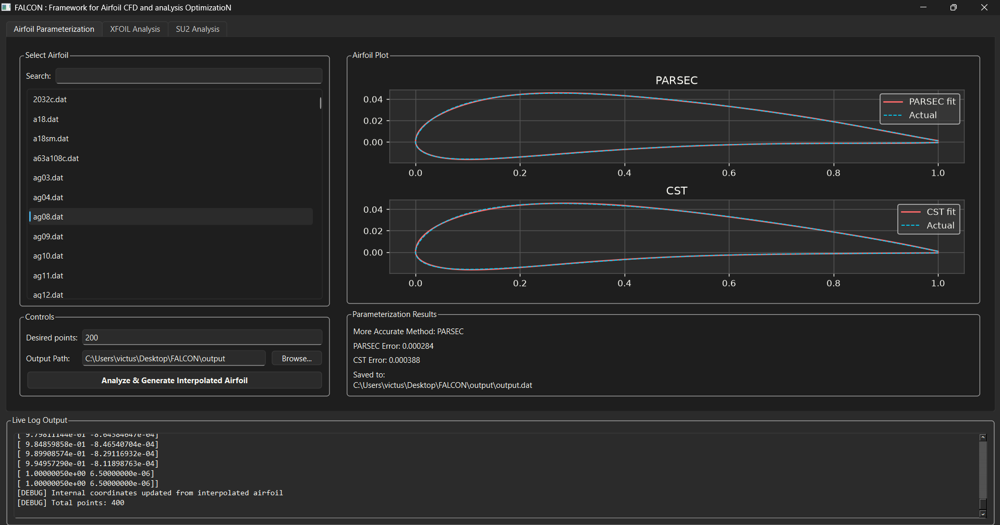
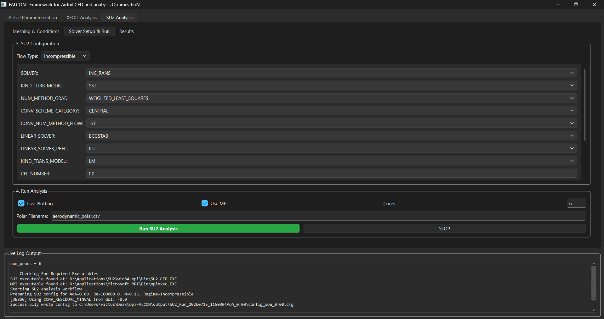

## Framework for Airfoil CFD and Analysis Optimization (FALCON)
<a name="top"></a>

[]()
[](https://opensource.org/licenses/MIT)

:star: Star us on GitHub - it is what keeps us going!

### About

FALCON is an open-source Python-based GUI framework designed to facilitate airfoil analysis; an optimization module is planned for v2.0. It integrates airfoil parametrization techniques (CST and PARSEC), low-fidelity aerodynamic analysis using XFOIL, automated meshing with GMSH, and high-fidelity CFD simulations via SU2 (with automated post processing). The framework aims to streamline the airfoil design process by providing a user-friendly interface and automating the stages of the analysis.

Geometry import and CST/PARSEC parameterization:



Automatically selected SU2 solver settings (editable before the run):



### Features

* User-friendly and easily accesible GUI.

* Airfoil parametrization using CST and PARSEC techniques.

* XFOIL (installed separately and run as an external executable) for low-fidelity aerodynamic analysis.

* Automated meshing using GMSH

* CFD analyses via SU2 with automated post-processing.

* Validated solver settings are pre-chosen on the basis of the given initial conditions.

* Real-time residual monitoring

### Pre-requisites

* SU2 $\rightarrow$ https://su2code.github.io/ $\rightarrow$ Can be installed with or without MPI. Add the address of the folder containing the SU2_CFD executable (bin folder) to the system's PATH variable.

* Microsoft MPI $\rightarrow$ https://www.microsoft.com/en-us/download/details.aspx?id=100593 $\rightarrow$ Verify that the path of the executable is stored in the system's PATH.

* XFoil $\rightarrow$ https://web.mit.edu/drela/Public/web/xfoil/ 

* Python $\rightarrow$ https://www.python.org/downloads/ $\rightarrow$ Python 3.11 and above versions are recommended for stable performance.

* Python specific packages $\rightarrow$

    - numpy
    - matplotlib 
    - scipy
    - PyQt6
    - pyvista
    - pandas
    - gmsh

### Installation

```bash
python -m pip install -r requirements.txt
```

### Automatic solver settings

"Load Recommended Settings" picks an SU2 configuration from the Mach and Reynolds numbers only
(the angle of attack is not used). Every setting can be changed before the run.

| Condition | Configuration | Model | Scheme | Time | CFL | Convergence |
|---|---|---|---|---|---|---|
| M ≥ 1 | Supersonic: compressible RANS | SST | Roe + MUSCL, Venkatakrishnan limiter; multigrid off | steady | adaptive, from 0.5 | RMS density 1e-6, 3000 iterations |
| 0.7 ≤ M < 1 | Transonic: compressible RANS | SA | JST (0.5, 0.005) | unsteady, dual time stepping | adaptive, from 1 | windowed Cauchy on CL, CD (1e-4), 5000 time steps |
| M < 0.7, Re ≥ 1e5 | Incompressible RANS | SST, with LM transition for Re ≤ 1e6 | JST | steady | 10 | RMS pressure 1e-8, 5000 iterations |
| M < 0.7, Re < 1e5 | Low Re: compressible RANS with low-Mach treatment | SST + LM (Tu 0.1 %, μt/μ 3) | LMROE + MUSCL, Venkatakrishnan limiter | unsteady, dual time stepping | adaptive, from 5 | windowed Cauchy on CL, CD (1e-5), 10000 time steps |

All configurations use weighted least-squares gradients, implicit time integration and FGMRES with ILU
preconditioning. The incompressible configuration neglects compressibility and is appropriate only for
M ≲ 0.3. The templates are in `Configuration_Files/`.

### Usage

```bash
python main.py
```

### Examples

Check out the Examples folder for the validated cases and usage description.

### Cite As

```bash
Prisha Desai, Anwak Manoj Kumar, and Manikandan Murugaiah "FALCON: Framework for Airfoil CFD and anaLysis OptimizatioN", https://github.com/Prisha22/FALCON
```

### References
1. Drela, M. (1989). XFOIL: An Analysis and Design System for Low Reynolds Number Airfoils. In: Mueller, T.J. (eds) Low Reynolds Number Aerodynamics. Lecture Notes in Engineering, vol 54. Springer, Berlin, Heidelberg. https://doi.org/10.1007/978-3-642-84010-4_1

2. SU2: An Open-Source Suite for Multiphysics Simulation and Design Thomas D. Economon, Francisco Palacios, Sean R. Copeland, Trent W. Lukaczyk, and Juan J. Alonso, AIAA Journal 2016 54:3, 828-846. https://doi.org/10.2514/1.J053813

2. Kulfan, B.M. Universal parametric geometry representation method. J. Aircr. 2008, 45, 142–158. https://doi.org/10.2514/1.29958

3. Sobieczky, H., “Parametric Airfoils and Wings,” Recent Development of Aerodynamic Design Methodologies, Springer, New York, 1999, pp. 71–87. https://doi.org/10.1007/978-3-322-89952-1_4

4. Geuzaine, Christophe & Remacle, Jean-François. (2009). Gmsh: A 3-D Finite Element Mesh Generator with Built-in Pre- and Post-Processing Facilities. International Journal for Numerical Methods in Engineering. 79. 1309 - 1331. https://doi.org/10.1002/nme.2579 